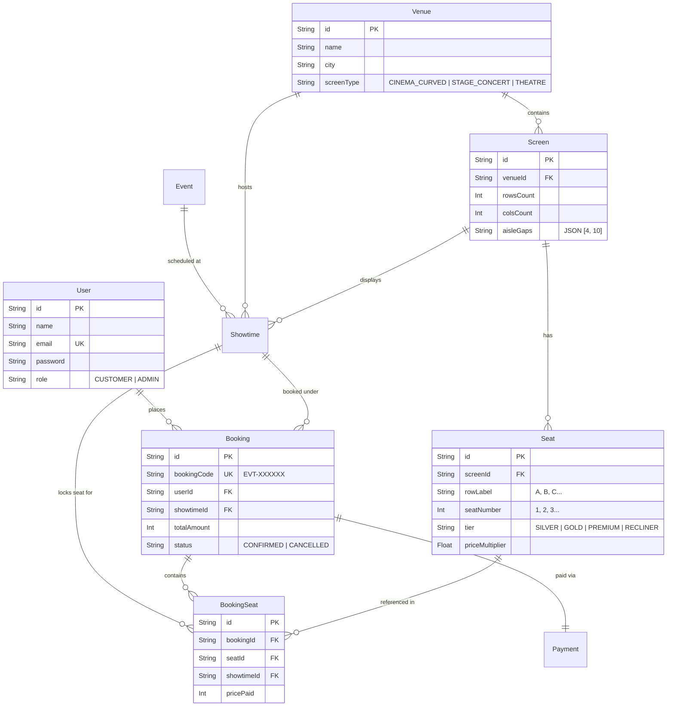

# 🗄️ Eventora Database & Venue Layout Guide

This directory documents the database architecture, file storage locations, and screen/seating layout configurations for **Eventora**.

---

## 📍 Where Is The Data Stored?

| Data Component | File Path | Description |
| :--- | :--- | :--- |
| **Active SQLite Database** | `server/prisma/dev.db` | The live local SQLite database storing all users, events, venues, screens, seats, showtimes, bookings, and payments. |
| **Prisma Schema Definition** | `server/prisma/schema.prisma` | Defines the relational schema, models, foreign keys, indexes, and unique constraints. |
| **Database Migrations** | `server/prisma/migrations/` | Version-controlled SQL migration history. |
| **Database Seeder** | `server/seed.js` | Script that populates initial venues, screens, seats, real event posters, and demo accounts. |
| **Layout Templates** | `database/layouts/` | Declarative JSON specifications for movie screens, concert arenas, and theatre proscenium layouts. |

---

## 🎭 Venue & Screen Layouts (`database/layouts/`)

Eventora supports multiple physical layout models depending on the event type:

### 1. Cinema Multiplex Curved Screen (`cinema_layout.json`)
- **Use Case**: Movies (*Pushpa 2, Dune 2, Kalki 2898 AD, Inside Out 2, Deadpool & Wolverine*)
- **Screen Geometry**: Curved glowing projection screen (`#22d3ee` cyan ambient glow) with `"ALL EYES THIS WAY • CINEMA SCREEN"` banner.
- **Seating Configuration**: 10 rows (A to J), 14 columns per row, dual aisle gangways at columns 4 and 10.
- **Tiers**: Classic Silver (Rows A-D), Executive Gold (Rows E-F), Prime Club (Rows G-H), Luxury Recliner (Rows I-J).

### 2. Live Concert Stadium Arena (`concert_layout.json`)
- **Use Case**: Concerts & Stadium Tours (*Taylor Swift, Coldplay, Diljit Dosanjh, Arijit Singh*)
- **Screen Geometry**: Elevated Performance Stage with dynamic magenta/pink concert lighting (`#ec4899`).
- **Seating Configuration**: 10 rows (A to J), 20 columns wide, wide stadium walkways at columns 5 and 15.
- **Tiers**: General Arena Stands, Golden Fan Circle, VIP Front Fan Zone, and Exclusive VIP Lounge Box.

### 3. Acoustic Theatre Proscenium (`theatre_layout.json`)
- **Use Case**: Broadway Plays, Musicals & Comedy (*Hamilton, The Lion King, Zakir Khan*)
- **Screen Geometry**: Proscenium Stage with warm gold lighting (`#eab308`).
- **Tiers**: Upper Balcony, Dress Circle, Orchestra Stalls, and Private Royal Box.

---

## 📊 Database Entity Relationship Diagram (ERD)

---

## 🎟️ Ticket Booking & Cancellation Rules

1. **Atomic Concurrency Protection**:
   Seats are protected by a unique database constraint `@@unique([showtimeId, seatId])` inside a Prisma atomic transaction. Two users cannot book the same seat at the same second.

2. **Full or Partial Cancellation**:
   - A customer booking multiple seats (e.g. 2 tickets) can choose to cancel **1 seat** or **all seats**.
   - Endpoint: `DELETE /api/bookings/:id/cancel` with body `{ seatIds: ["seat_id_1"] }`.
   - When a subset of seats is cancelled, only those `BookingSeat` records are deleted, freeing the physical seats immediately for other customers, while the remaining seats stay confirmed with an updated booking total and a 95% refund calculation.
   - When all seats are cancelled, the booking status transitions to `CANCELLED`.
